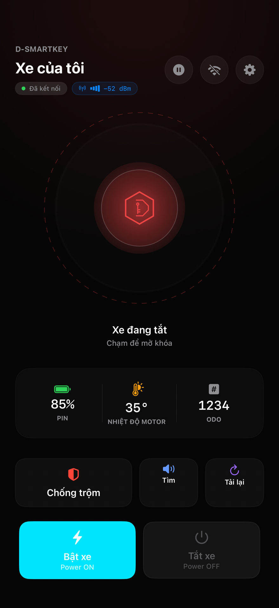
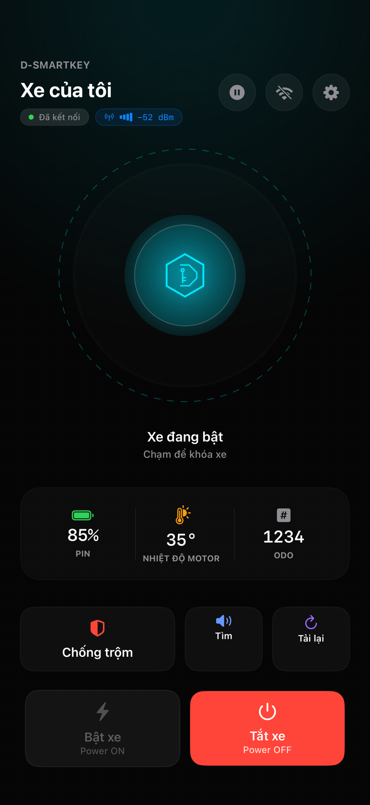
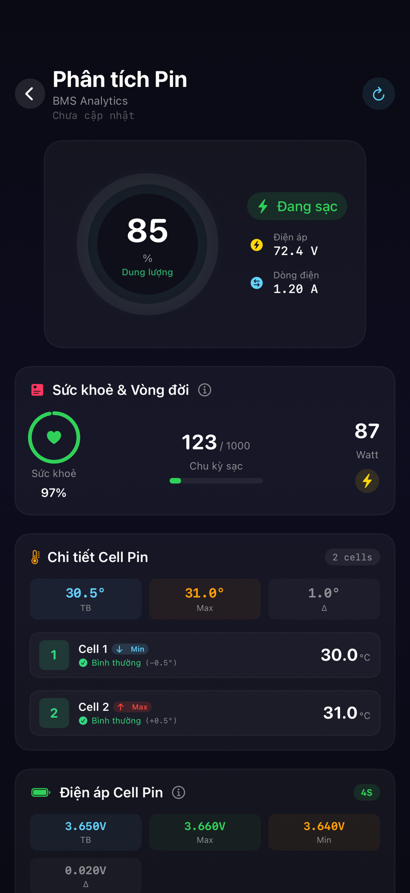
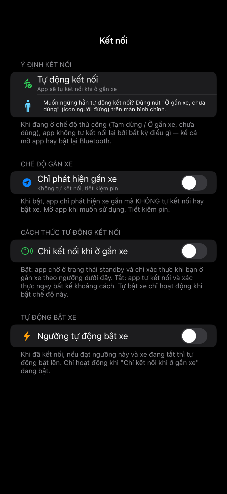

# D-SmartKey Lite

Ứng dụng iOS mã nguồn mở do cá nhân phát triển để nghiên cứu khả năng tương tác qua Bluetooth LE và sử dụng trên **chiếc xe thuộc sở hữu của chính bạn**. Mã nguồn hiện hướng tới một số xe Dat Bike; khả năng tương thích phụ thuộc mẫu xe, firmware và iOS.

> **Dự án độc lập, không phải sản phẩm chính thức của Dat Bike.** D-SmartKey Lite và các tác giả không trực thuộc, không đại diện, không được tài trợ, chứng nhận, bảo trợ hay bảo đảm bởi Dat Bike. Tên Dat Bike và tên các mẫu xe chỉ dùng để mô tả khả năng tương thích; quyền đối với các nhãn hiệu thuộc chủ sở hữu tương ứng.

[MIT License](LICENSE) · [Bảo mật](SECURITY.md) · [Quyền riêng tư](PRIVACY.md)

## Phạm vi sử dụng: xe của chính bạn

- Chỉ sử dụng, nghiên cứu, sửa đổi và thử nghiệm phần mềm để giao tiếp với **xe thuộc sở hữu hợp pháp của chính bạn**. Việc nhìn thấy tên, service UUID hoặc tín hiệu Bluetooth của một xe không cho phép bạn kết nối, ghép đôi hay điều khiển xe đó.
- Dự án không nhằm truy cập xe của người khác, chiếm quyền điều khiển, vượt cơ chế xác thực, lấy PIN/khóa, theo dõi chủ xe hoặc vô hiệu hóa tính năng bảo vệ của xe.
- Phạm vi mã ứng dụng được rà soát là giao tiếp BLE từ iPhone: ghép đôi, xác thực, đọc dữ liệu và gửi lệnh điều khiển/cấu hình. Ứng dụng **không cung cấp chức năng nạp hay sửa firmware xe**. Các lệnh BLE vẫn có thể thay đổi trạng thái xe, thông tin ghép đôi và thời gian trên xe; đây không phải công cụ chỉ đọc.
- Đây là nguyên tắc sử dụng và an toàn của dự án. **Ứng dụng không xác minh giấy tờ hay quyền sở hữu xe**, và README không tạo ra một hàng rào kỹ thuật ngăn lạm dụng. Quyền đối với mã nguồn được quy định riêng trong [LICENSE](LICENSE); các hướng dẫn này không sửa giấy phép MIT.

## Miễn trừ bảo đảm và giới hạn trách nhiệm

Mã nguồn, tài liệu và bản dựng được cung cấp **theo hiện trạng (AS IS)** và theo giấy phép MIT, không kèm cam kết về tính chính xác, chất lượng, độ tin cậy, tính phù hợp, khả năng tương thích, tính sẵn sàng hoặc việc không có lỗi/lỗ hổng bảo mật. Không bảo đảm ứng dụng sẽ luôn kết nối được, bật/tắt/khóa đúng lúc, xác nhận đúng trạng thái xe hoặc ngăn được mất cắp.

**Trong phạm vi pháp luật áp dụng cho phép**, tác giả, người giữ bản quyền và người đóng góp không chịu trách nhiệm đối với tổn thất phát sinh từ việc tải, biên dịch, sửa đổi, phân phối hoặc sử dụng mã nguồn/sản phẩm: lỗi phần mềm, lỗ hổng hoặc sự cố bảo mật, mất dữ liệu hay thông tin xác thực, truy cập trái phép, mất cắp xe, hư hỏng xe/điện thoại/tài sản, tai nạn, thương tích, gián đoạn sử dụng hoặc thiệt hại trực tiếp/gián tiếp. Không điều khoản nào ở đây nhằm loại trừ trách nhiệm hoặc quyền bắt buộc mà pháp luật không cho phép loại trừ. Nội dung này không phải xác nhận rằng mọi miễn trừ đều có hiệu lực trong mọi trường hợp.

Người sử dụng tự đánh giá mã nguồn, bảo vệ điện thoại/PIN, quyết định việc cài đặt và thử nghiệm trên xe của mình, đồng thời tuân thủ pháp luật, quy tắc an toàn và điều kiện bảo hành áp dụng. Người sửa đổi hoặc phân phối bản dựng chịu trách nhiệm đánh giá thay đổi, cấu hình ký, dữ liệu và tuyên bố đi kèm bản dựng của mình; không được tuyên bố rằng bản đó được Dat Bike hoặc tác giả gốc bảo đảm.

D-SmartKey Lite không thay thế thẻ/chìa khóa vật lý, quy trình vận hành của nhà sản xuất hoặc một hệ thống chống trộm được chứng nhận. Luôn giữ phương án mở/khóa xe chính thức. Chỉ kiểm thử khi xe dừng ở nơi an toàn; không thao tác điện thoại hoặc thử lệnh bật/tắt/khóa khi đang lái xe.

## Ảnh màn hình

Giao diện thật được render trên iPhone Simulator với **dữ liệu mẫu**, không kết nối hay điều khiển xe thật. Các số liệu và trạng thái dưới đây chỉ để minh họa; không chứa định danh xe hoặc tài khoản cá nhân.

| Xe đang tắt | Xe đang bật |
|:---:|:---:|
|  |  |

| Phân tích pin | Cài đặt kết nối |
|:---:|:---:|
|  |  |

## Chức năng và giới hạn thực tế của Lite

Phiên bản mã hiện tại: **5.3.0 (1019)**. Đây không phải xác nhận về bản đang phát hành trên App Store. Repo dùng nhánh `main`.

| Hạng mục | Phạm vi trong mã hiện tại |
|---|---|
| Nền tảng | iOS 16 trở lên, SwiftUI + CoreBluetooth, điều kiện biên dịch `NOASK` |
| Ghép đôi/xác thực | PIN do ứng dụng sinh, luồng xác thực BLE và thao tác thẻ NFC trên xe tùy firmware |
| Điều khiển | Bật/tắt, yêu cầu chống trộm, tìm xe; trạng thái phản hồi có thể lỗi hoặc chậm |
| Hiển thị | Trạng thái khóa, pin, thông tin xe và telemetry do firmware cung cấp |
| Tự bật khi gần | Tùy chọn; RSSI chỉ là ước lượng tín hiệu, không chứng minh khoảng cách hay danh tính chủ xe |
| Hoạt động nền | Lite không khai báo `bluetooth-central`, không bật CoreBluetooth state restoration và không dùng AccessorySetupKit; không bảo đảm tiếp tục điều khiển khi app ẩn, bị tạm dừng hoặc vuốt tắt |
| Tương thích | Chưa có nghiệm thu đầy đủ trên mọi mẫu xe, firmware hoặc phiên bản iOS |

Có mã dùng chung với bản Full/ASK. Sự có mặt của file `ASKManager.swift` **không** có nghĩa tính năng đó được bật trong Lite. Dùng `project.yml`, `Info.plist` và điều kiện `NOASK` để đối chiếu cấu hình.

**Còn lỗi đã biết:** callback BLE muộn có thể nhận nhầm yêu cầu mới; deep link có thể gửi lệnh vật lý mà không xác nhận trong app; nhánh auto bật có thể cấp lại lượt thử sau lỗi đọc trạng thái. Miễn trừ trách nhiệm không khắc phục các lỗi này và không thay thế kiểm thử.

## Bảo mật và dữ liệu trên thiết bị

- PIN production được lưu trong Keychain, lớp `AfterFirstUnlockThisDeviceOnly`; tùy chọn và một số định danh xe nằm trong UserDefaults/App Group. Không coi sandbox hoặc Keychain là bảo đảm tuyệt đối khi điện thoại bị chiếm quyền.
- Nhật ký INFO/BLE/lỗi vẫn được ghi cục bộ dù tắt log chi tiết. File có thể chứa định danh xe, thời điểm sử dụng, RSSI và một phần dữ liệu xác thực; giới hạn lưu trong mã hiện tại là 365 ngày và dọn khi logger khởi tạo.
- Che dữ liệu lúc xuất log là tùy chọn; không có nghĩa file gốc đã được ẩn danh. Đọc lại log/ảnh/QR trước khi chia sẻ. Không đăng PIN, challenge/response, số khung, địa chỉ thiết bị, private key, profile ký hoặc dữ liệu của người khác.
- Không thấy chức năng tự tải telemetry/log lên máy chủ trong mã ứng dụng được rà soát. Mở liên kết hỗ trợ, dùng share sheet hoặc công cụ phân phối là hành động riêng có thể đưa dữ liệu ra ngoài thiết bị.
- Chính sách mã hóa/xác thực trên xe phụ thuộc firmware và iOS. Không có chứng nhận kiểm toán bảo mật độc lập hoặc bảo đảm chống mọi hình thức truy cập trái phép.

Báo cáo bảo mật: [dev@d-smartkey.io](mailto:dev@d-smartkey.io). Không đăng chi tiết khai thác hay dữ liệu nhận diện lên issue công khai; xem [SECURITY.md](SECURITY.md).

## Biên dịch và kiểm thử

Cần macOS, Xcode có SDK phù hợp với các API trong source và XcodeGen nếu tái tạo project. Lượt rà soát này build bằng Xcode 27.1; deployment target vẫn là iOS 16. Không có dependency SPM/CocoaPods trong app. BLE thật cần iPhone và xe của chính bạn; Simulator không chứng minh hành vi trên xe.

```bash
# Nhánh main của repo độc lập này đã là cấu hình Lite.
open DBikeSmartkey.xcodeproj

# Chỉ chạy khi thay đổi project.yml và cần tái tạo project.
xcodegen generate

# Build Simulator, không cần ký và không gửi lệnh tới xe.
xcodebuild -project DBikeSmartkey.xcodeproj -scheme DBikeSmartkey \
  -configuration Debug -destination 'generic/platform=iOS Simulator' \
  -derivedDataPath build/simulator CODE_SIGNING_ALLOWED=NO build
```

Trước khi build cho điện thoại, thay cấu hình team, bundle ID, App Group và export/signing bằng định danh của bạn trong project, plist và entitlements tương ứng. Project không gắn Apple Team ID; chọn team của bạn trong Xcode trước khi ký. Cấu hình trong repo không cấp quyền dùng chứng chỉ hay tài khoản của tác giả. Không commit khóa ký, provisioning profile, `.secrets/`, logs hoặc dữ liệu xe thật.

Chạy test bằng scheme `DBikeSmartkey` trên một iPhone Simulator có sẵn trong Xcode. Ghi đúng pass/skip/fail; build thành công và test giả lập không xác nhận tính an toàn trên xe thật.

## Đóng góp và giấy phép

Đọc [CONTRIBUTING.md](CONTRIBUTING.md), [SECURITY.md](SECURITY.md) và [LICENSE](LICENSE). Mọi thử nghiệm lệnh vật lý phải do bạn chủ động thực hiện trên xe của chính bạn; không tự gửi lệnh trong CI, test tự động hoặc công cụ hỗ trợ.

Giấy phép nguồn: **MIT**, © 2026 D-SmartKey contributors. Giữ nguyên thông báo bản quyền và giấy phép khi phân phối theo MIT. Tham khảo [toàn văn MIT tại Open Source Initiative](https://opensource.org/license/mit). Giấy phép mã nguồn không cấp quyền đối với nhãn hiệu Dat Bike, phần mềm của hãng hoặc tài sản của người khác.

### English notice

D-SmartKey Lite is an independent personal open-source interoperability project. It is not affiliated with, endorsed, sponsored, certified or warranted by Dat Bike. Dat Bike names and trademarks identify intended compatibility only and belong to their respective owners.

Use and test the software only with **a vehicle you legally own**. It is not intended to bypass authorization or control another person's vehicle. The app does not verify legal ownership. This is a usage and safety policy; the source license remains MIT.

The code, documentation and builds are provided **AS IS**, without warranties. To the extent permitted by applicable law, the authors, copyright holders and contributors disclaim liability for losses arising from use, modification or distribution, including security incidents, unauthorized access, theft, property damage, accidents and injury. Mandatory legal rights and liabilities remain unaffected. Users assess and accept the risks of their own installation, changes and vehicle tests. No security, anti-theft, compatibility or background-operation guarantee is made. Keep the manufacturer's physical key/card and never test vehicle commands while riding.
